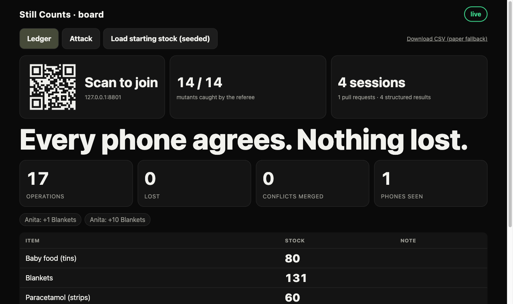

# Still Counts

**A field-team ledger that keeps counting with the internet pulled.** Any team that counts stock in a disaster (floods, earthquakes, a clinic after a storm, a food bank) can keep tapping on their phones with no signal. The counts queue on the phone and merge deterministically when the connection returns: every operation has a unique id, so none is applied twice, and the ledger is a function of the set of operations, not of the order they arrived in.

Built for Devin Hacks Kochi (24 Oct 2026). Track: *Works anyway* (unreliable internet). A Kochi relief camp is the worked example; nothing in the code is specific to one place.

**How sure are we?** A simulated attack harness (below) runs 24 hostile scenarios. Most pass; two still fail on some seeds and are listed openly. The board's headline is built from what the phones report, never from a claim of "nothing lost".



## How the merge works
The ledger is a set of operations, each with a unique id. The state is a pure function of that set, so any delivery order, any duplicates and any split-and-merge give byte-identical results.
- Quantities are sums of signed integer adjustments.
- Names, notes and deletions are last-writer-wins by (Lamport time, replica id), never by the phone's wall clock.
- Stock that goes negative after a merge (two phones issued the last blankets) is flagged for a human, not hidden.

## The referee
`oracle/` replays the same operations in hundreds of random orders, with duplicates, and fails if any result differs. It also catches deliberately broken merges. The agents that attack the product may run the oracle but are never allowed to edit it (`.github/CODEOWNERS`).

```bash
python3 -m venv .venv && .venv/bin/pip install -r requirements.txt
.venv/bin/python -m pytest -q
node --test client/test/
.venv/bin/python -m oracle.oracle --seed 0xA3 --ops 240 --perms 200
.venv/bin/python -m uvicorn server.app:app --host 0.0.0.0 --port 8000
```

## Earn the Code (Learn mode)
`learn/stages.json` holds four stages (duplicate ids, signed adjust sum, Lamport last-writer-wins, oversell flag). Each has predict cases whose answers come from the real merge, a find-the-bug item built from a real mutant in `oracle/mutation.py`, a small function to write and an explain rubric. `learn/grader.py` grades all four checkpoints with plain code: written functions are checked (no imports, no underscore attributes), run in a subprocess with a builtins whitelist and CPU, memory, file-size and process limits, plugged into the real ledger code and judged by the referee. This is defence in depth, not a security boundary: the write endpoint only accepts a browser on the base laptop unless the host sets `STILLCOUNTS_LEARN_WRITE_LAN=1`, and a public deployment should run the server in a container as an unprivileged user. Edit the content in `learn/build_stages.py`, then regenerate:

```bash
.venv/bin/python -m learn.build_stages
```

Open `/` : Earn the Code is the front door. The old ledger phone app is Course 1 live app at `/static/ledger.html`, and `/static/learn.html` is the same front door. Four tabs: **Course** (locked stages, hints, reveal of the real code with a diff of your function against it), **Understanding** (every line of the code coloured by what you earned: unseen, predicted, bug spotted, written, explained, plus the pasted-vs-understood gap score), **Results** (before and after quiz, first-try pass rate, hints used, lines unlocked vs lines written, Devin's scaffold lines vs yours) and **Proof** (a shareable card, copied as text or downloaded as SVG). Everything is counted on the phone from your own attempts; the card says it is self-reported, not an exam. The quiz is the lesson's cases with the numbers changed, graded by the real merge in the browser (`client/understand.js`, `client/learn_views.js`). Predict is graded in the browser with the same merge so it works with no signal, and the lessons are cached on the phone after the first visit; find the bug, write and explain go through `/api/learn` and need the base, which keeps the real merge code locked until predict, find the bug and write are earned.

## Referee Race
Open `/race` on a phone (the Race link on the phone app, or the QR code on the board's Race tab). Every phone gets the same operations in its own shuffled order with duplicates and races to predict the merged stock. The answer key is the real merge, so the round shows that order does not matter. The host starts rounds from the board.

Screens (refreshed with Playwright against a seeded local run): phone app `docs/screenshots/phone-app.png`, offline with taps queued `phone-offline.png`, board attack tab `board-attack.png`, race `board-race.png`, learn `phone-learn.png`. The attack tab and the Devin panel show real committed data; the two phones in the ledger shot are scripted API calls, not people.

## Run it and the 3-minute demo
`scripts/run.sh` installs from `requirements.txt` and serves the base on port 8000 (phone app at `/`, board at `/board`). `docs/DEMO.md` is the timed script. Set `STILLCOUNTS_DATA_DIR` to keep the log somewhere other than `data/`. The PWA ships a home-screen icon and works offline after the first load.

## Chaos simulation
`chaos/` is a deterministic simulation of the 24 scout scenarios (dropped, duplicated and reordered requests, clock jumps, crashes, restores, two tabs on one phone). Run it with `.venv/bin/python -m chaos.run --seeds 0:500 --summary data/chaos_summary.json` (about 18 minutes); the full per-run output goes to `data/chaos_results.json` (git-ignored) and `data/chaos_summary.json` is a small committed summary of a real 500-seed run.

It found real product bugs. Before this round 8 of the 24 scenarios failed (3506 of 12500 runs, 92222 ops lost). Now 3 fail and 671 of 12500 runs (65686 ops lost, almost all one scenario). The committed `data/chaos_summary.json` is a real 500-seed run of the current code and the board's Attack tab shows it per scenario.

Fixed by hand (the Devin writer reported them but opened no fix pull requests):
- Positional cursor after the base's log shrank, shifted or was wiped: the phone now sends the id of the last entry it read; if the base's epoch, length or that entry disagrees it answers `reset`, and the phone offers back every op the base no longer has.
- A phone clock or stored Lamport value pushed far ahead: the base rejected real taps as "skew too large" and the phone dropped them. The base now returns its newest Lamport time and the phone re-stamps the refused op after it and sends it again.
- Two tabs on one phone overwriting each other's queue: a tab takes over any op it has never seen before it writes.

Still open, pinned as strict expected failures in `tests/test_regress_*.py` (these are not fixed):
- `life_storage_quota` (427 of 500 runs): when browser storage is full the phone now keeps only unsent ops on disk and shows a warning, but if the unsent ops alone exceed a tiny simulated quota (3 to 40 KB; real browsers allow about 5 MB) and the page reloads while offline, they are lost.
- `net_retry_same_id_new_content` (240 of 500): the harness injects a client that edits a queued op in place or reuses an old id; the base rightly refuses a changed op with the same id, so that edit is lost. The shipped app never does this.
- `net_restore_old_backup` (4 of 500, one op each): a rare ordering after a restore from an older backup.

## Devin
Devin sessions propose hostile network scenarios (partitions, reordering, duplicates, clock skew), build a chaos harness, run it against the oracle and open pull requests for anything they break. `docs/devin.md` lists all 9 sessions, the 5 pull requests (a human pressed merge on each) and the work that was overridden or never merged; ACU use is not recorded and the page says so.

## Licence
MIT.

## Socials & Support
- Portfolio: https://ryyansafar.site
- GitHub: https://github.com/ryyansafar
- Buy Me a Coffee: https://buymeacoffee.com/ryyansafar
- PayPal: https://www.paypal.com/paypalme/ryyansafar
- Razorpay: https://razorpay.me/@ryyansafar
