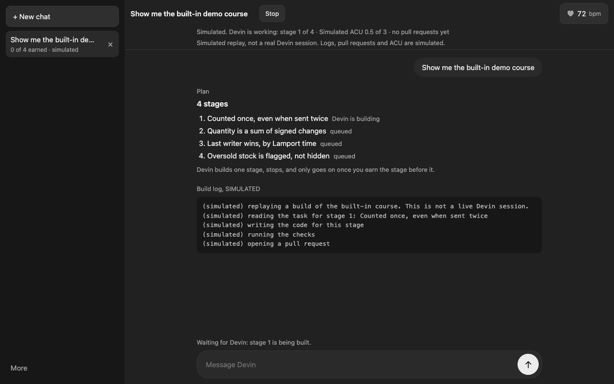

# Earn the Code

**An AI builds your app one stage at a time and stops until you prove you understand the stage.**

AI can build an app in minutes, but people cannot explain what it built. Earn the Code is an ordinary chat app: you say what to build, Devin (or a clearly labelled replay of a past real Devin session) posts a plan of 3 to 4 stages and builds stage 1, then **stops**. The stage's code is locked. A checkpoint appears as a normal assistant message. Pass it and the code unlocks with a highlighted diff and the build goes on. Fail it and you get a hint and a retry; the build stays stopped. It also notices when you are stressed (heart rate) and makes the next steps easier.

Course 1 is the real code in this repository: the offline ledger's merge (an operation log with Lamport clocks). It is the code you earn. (The repository and its URL are still called `stillcounts`.)

Built for Devin Hacks Kochi (24 Oct 2026).



## What you see

- A plain chat screen: left sidebar (New chat, chat list, a quiet **More** menu with the other pages and the links below), one message column, a composer at the bottom. One dark theme, one font, one muted accent.
- Everything simulated or replayed carries one small plain label ("Simulated replay, not a real Devin session"). It is never hidden.
- A small heart-rate item in the top bar (see below).

The flow, in the order the demo path takes it:

1. **New chat**, type what to build (or press "Try the built-in demo"). With no Devin token, or when Devin errors or is out of quota, the chat says so in the thread and switches to the labelled replay of the built-in course.
2. A **plan** of four stages appears. Devin builds stage 1 and **stops**: "Devin has stopped. Earn stage 1 to let it go on." Nothing is built ahead.
3. The **checkpoint** for stage 1 is an assistant message (below). A wrong answer names what was wrong, never the answer, and stage 2 is not started.
4. Pass predict, find the bug and write: the stage's code **unlocks with a diff** and Devin is told to continue with the next stage.
5. **Heart rate**: a sudden rise lowers the difficulty one level, and the thread says why ("HR 112 vs baseline 72: switching to easier steps"). When you calm down it restores one level at a time.

## The four checkpoints

Defined in `learn/stages.json` (built by `learn/build_stages.py`), graded by `learn/grader.py` and `learn/cases.py` through `server/learn_api.py`:

| Checkpoint | What you do | Who grades it |
|---|---|---|
| **Predict** | Say what your own cases return. The numbers are generated for you on the server from a per-learner seed. A wrong guess names only the wrong case, never the right answer, and that case is replaced by a new one with different numbers. | Plain code, on the server: it runs the real merge on your cases. On the Learn page, with no signal, the browser grades with the public JavaScript twin; that pass is provisional and stands only if the server agrees later. |
| **Find the bug** | You see a short excerpt of a copy of the code in which one line was changed. Click the changed line and pick which of four statements names the cause. Both must be right. A wrong pick says nothing about which half was wrong, locks the options for 30 seconds and reshuffles them. | Plain code, against the known mutant. |
| **Write** | Write one small function. | Plain code. The source is checked (no imports, no underscore attributes), run in a bare namespace that holds only ledger symbols, with a builtins whitelist, a 5 s timeout, CPU, file-size and process limits and a 256 MB allocation guard, and judged by the real referee. |
| **Explain** | Say in your own words why it works: real sentences, at least 25 words, one sentence per rubric point. | Plain code, not a model: keyword and number matching. The points are shown after you answer. It is practice only and **never unlocks anything alone**. |

A stage unlocks, and the unlock is recorded for you on the server, once predict, find the bug and write are passed. Four stages exist: duplicate ids, signed adjustment sum, Lamport last-writer-wins, oversell flag.

## Heart rate

A top-bar item opens a popover with a **simulator** slider (40 to 190 bpm) and **Spike**, **Calm** and **Calibrate baseline** buttons. A sudden rise against your baseline lowers the difficulty one level; the thread states the numbers and the reason, and a live Devin session is told in plain words to make the next stage smaller (no heart-rate number is sent to it).

| Level | What changes |
|---|---|
| 3 | Normal. |
| 2 | A hint is shown and the steps are smaller (one predict case at a time). |
| 1 | Guided fill-in or multiple choice for write, answer starters for explain, and a breathing prompt. Devin's next message is held back for a moment. |

It never auto-passes anything. Heart rate stays on the device: the server only receives the level change, never a reading. The Bluetooth heart-rate strap path follows the spec but is untested without hardware; the simulator is what the demo uses. This is not a medical device.

## The live Devin bridge (optional)

`server/devin_bridge.py` and `server/live_course.py` start a real Devin session for your prompt, ask it to stop after each stage, poll it (status, plan, stages, pull requests), and tell it to continue only after the stage is earned. The bridge enforces this itself: a continue for a stage that is not earned is refused with 403 whatever the browser asks, and a session can only be graded by the browser that started it (the server-issued cookie). `client/devin_live.js` and `client/chat_bridge.js` are the browser side. The token never reaches the browser.

Set `DEVIN_TOKEN` and `DEVIN_ORG` in the environment (or point `STILLCOUNTS_DEVIN_ENV` at an env file). Optional: `GITHUB_TOKEN` for pull-request and CI details. On any error, missing token, usage limit or an unreachable bridge, the chat falls back to the labelled replay and says why. This path has not been exercised against Devin in the final integration run (no token was available); the bridge itself is covered by `tests/test_devin_bridge.py` with a fake Devin.

## Pages

| Path | What |
|---|---|
| `/` | The chat (root page). |
| `/static/learn.html` | The Learn page: the course as tabs (Course, Understanding map and gap score, Results, Proof card), the same checkpoints, with offline predict. |
| `/ledger` | The Course 1 ledger phone app: it keeps counting with no signal and merges when the signal returns. |
| `/board` | The base-laptop board: ledger, attack results, proof and race tabs. |
| `/race` | Referee Race: phones predict the same merged stock in their own shuffled operation order. |
| `/static/results.html` | Results dashboard (counts attempts and difficulty changes; self-reported). |

## Run it

```bash
python3 -m venv .venv && .venv/bin/pip install -r requirements.txt
scripts/run.sh          # serves on port 8000; the root page is the chat
scripts/run.sh test     # the whole suite, Python then JavaScript
STILLCOUNTS_OPEN=1 scripts/run.sh   # no join token (a quick look, or an isolated network)
```

| Variable | Effect |
|---|---|
| `STILLCOUNTS_OPEN=1` | Turn the join token off. Without it a fresh token is generated per run and the board's QR code carries it. |
| `STILLCOUNTS_TOKEN` | Use this join token instead of a random one. |
| `STILLCOUNTS_LEARN_WRITE_LAN=1` | Let phones and other machines use the **Write** checkpoint. Without it the server answers them 403 and only a browser on the base laptop can submit code. Code a learner types runs on the laptop in the sandbox (defence in depth, not a security boundary): use it only on a network you trust. |
| `STILLCOUNTS_DATA_DIR` | Keep the log and learner records somewhere other than `data/`. |
| `DEVIN_TOKEN`, `DEVIN_ORG`, `STILLCOUNTS_DEVIN_ENV`, `GITHUB_TOKEN` | The optional live bridge (above). |
| `STILLCOUNTS_TLS_CERT`, `STILLCOUNTS_TLS_KEY` | Serve HTTPS (phones need `https://` or `localhost` to keep the app for offline use; `docs/DEMO.md` has the mkcert steps, untried on real phones). |
| `PORT` | Port (default 8000). |

`docs/DEMO.md` is the timed demo script.

### Tests

```bash
.venv/bin/python -m pytest -q
node --test client/test/
.venv/bin/python -m oracle.oracle --seed 0xA3 --ops 240 --perms 200
.venv/bin/python -m oracle.mutation
```

CI (`.github/workflows/ci.yml`) runs the same, with 90% coverage required, plus the mutmut job on the merge.

## What is real and what is not

| Piece | Status |
|---|---|
| Chat as the root page, stop-until-earned gate, replay labelled SIMULATED, four checkpoints graded on the server, unlock recorded per learner, diff on unlock | Real, on main |
| Heart-rate adaptation from the simulator slider, three levels, reason in the thread, gradual restore | Real, on main |
| Live Devin bridge with fallback to the replay | Built and tested against a fake Devin; not run against a real session in the final integration |
| Bluetooth heart-rate strap | Written to the spec, untested without hardware |
| Learn page (map, gap score, quiz, results, proof card), ledger phone app, board, Referee Race, attack harness (25 scenarios, 500 seeds each) | Real, on main |
| `learn/make_course.py`: build stages from another repository's functions (`python -m learn.make_course`) | An engine with tests, run from the command line; not wired into the chat |
| Aiming the next checkpoint at your weakest function, Devin help that fades as you improve, streaks | Not built |

## How the merge works

The ledger is a set of operations, each with a unique id. State is a pure function of that set, so any delivery order, any duplicates and any split-and-merge give byte-identical results.
- Quantities are sums of signed integer adjustments.
- Names, notes and deletions are last-writer-wins by (Lamport time, replica id), never by the phone's wall clock.
- Stock that goes negative after a merge is flagged for a human, not hidden.

`oracle/` replays the same operations in hundreds of random orders, with duplicates, and fails if any result differs. It also catches 14 deliberately broken merges that we wrote ourselves (a demo set; `docs/mutation.md` has the independent mutmut run).

## Architecture

```
browser (client/)                              base laptop (server/)
  chat.js, chat_core.js, chat_ctl.js  <--->     app.py          routes, ops log, board
  chat_replay.js (labelled replay)              learn_api.py    stages, per-learner progress, unlocks, sandboxed write
  chat_bridge.js, devin_live.js                 devin_bridge.py live Devin sessions (token stays here)
  hr.js, stress.js, hr_widget.js                live_course.py  course built from a live Devin's structured output
  learn.js (Learn page), app.js (ledger)        results_api.py, race_api.py
  crdt.js (public twin of the merge)            learn/          stages, cases, grader and sandbox
  sw.js (offline shell)                         stillcounts/crdt.py  the merge (agents may not edit)
                                                oracle/              the referee (agents may not edit)
                                                chaos/               hostile-scenario simulation
```

The server tells browsers apart by a random id it issues itself in an HttpOnly cookie (`sc_learner`); page scripts cannot read or choose it. A new chat sends only an attempt name (`X-Attempt`), so it starts the course from zero; the attempt can never reach another browser's progress.

## Honest limitations

- Nothing here is secret. The merge is public Python in this repository and `client/crdt.js` is a public JavaScript twin that ships to every browser, so anyone can run it. What the server gates is the guided path, the reference-solution reveal and the unlock record. Predict answers can be computed by anyone who runs the public merge on the cases they are shown; per-learner numbers stop answers being passed between learners, not scripted. A pass is practice, not proof of understanding.
- Explanations can be bluffed (keyword matching with a length floor, one sentence per point and a check of your own numbers), which is why explain never unlocks anything.
- On the chat, grading needs the server. With the network off the chat still opens and replays, but a checkpoint answer says "needs a signal". Offline predict with provisional passes exists on the Learn page only.
- The find-the-bug lock lives in the server's memory (restarting clears it).
- Only one course exists, and it is about one small merge function.
- The write sandbox is defence in depth, not a security boundary: RLIMIT_AS works on Linux only, the 256 MB allocation guard works on macOS and Linux, and a public deployment should run the server in a container as an unprivileged user.
- Three attack scenarios still fail on some seeds: `life_storage_quota`, `net_retry_same_id_new_content` and `net_restore_old_backup`. `data/chaos_summary.json` has the real numbers of a 500-seed run (671 of 12500 runs failed). They are pinned as strict expected failures in `tests/test_regress_*.py`.
- The Results numbers and the proof card are self-reported demo numbers, not a study: no control group, tiny sample.

## How Devin was used

`docs/devin.md` lists every session (generated from `data/devin_evidence.json`).

- 9 Devin cloud sessions: 3 read-only scouts, 5 writers, 1 browser QA. 5 pull requests, all merged by a human pressing merge. 5 issues filed by the QA session.
- What Devin produced: three lists of hostile scenarios (24 in total; the harness adds one control run, so the board shows 25), the first version of the chaos harness, and scaffolding for the learn API, the learn UI, Referee Race and the board tabs.
- Rejected or overridden: the chaos writer's 2.3 MB results file (replaced by a small summary); the first write grader, which accepted `import os` (rewritten by hand, then fixed again after a review found `json.codecs.sys.modules['os']`, which is now a regression test); eight failing scenarios with no fix pull requests (every fix written by hand); a QA branch that never became a pull request.
- Devin never touched the merge function or the referee: `.github/CODEOWNERS` protects them and CI fails any `devin/*` branch that edits them.
- The chat shell, heart-rate engine, live bridge, built-in course and the integration that made the chat the root page were not part of those nine sessions and are not credited to Devin. ACU use was never recorded and is not claimed.

## Licence

MIT.

## Socials & Support
- Portfolio: https://ryyansafar.site
- GitHub: https://github.com/ryyansafar
- Buy Me a Coffee: https://buymeacoffee.com/ryyansafar
- PayPal: https://www.paypal.com/paypalme/ryyansafar
- Razorpay: https://razorpay.me/@ryyansafar
