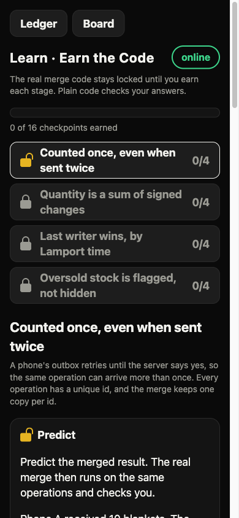

# Earn the Code

**Devin builds the app. You earn each piece of its code by showing you understand it.**

Earn the Code is a learning tool for people who paste AI-written code they do not understand. Code arrives locked, one stage at a time. To unlock a stage you predict what it does, find a bug planted in it, write one small piece yourself and explain it in your own words. The first course is the real app in this repository: an offline-first ledger whose merge code is the thing you earn. (The repository and its URL are still called `stillcounts`.)

Built for Devin Hacks Kochi (24 Oct 2026).



## The problem

People now accept code they cannot read. Anthropic ran a randomized trial in January 2026 on people learning a new Python library: the group that used AI assistance scored 50% on a skills quiz, against 67% for the group that coded by hand, and the biggest gap was in debugging. Read the numbers with care: the sample was small and the quiz came right after the task, so it says nothing about long-term skill. It does match what most of us feel: pasted code does not leave understanding behind, and you cannot see the gap until something breaks.

## The four checkpoints

Each stage of the course has the same four, defined in `learn/stages.json` (built by `learn/build_stages.py`, graded by `learn/grader.py`):

| Checkpoint | What you do | Who grades it |
|---|---|---|
| **Predict** | Say what a snippet returns for given inputs (for example, what is the stock of an item after these phones merge?). | Plain code. The answer key comes from running the real merge. In the browser it uses the same merge, so it works with no signal. |
| **Find the bug** | You see a copy of the code changed by one line (a real mutant from `oracle/mutation.py`) and pick which of four statements says what is wrong. | Plain code, against the known mutant. |
| **Write** | Write one small function. | Plain code. It is checked (no imports, no underscore attributes), run in a subprocess with a builtins whitelist and CPU, memory, file-size and process limits, plugged into the real ledger code and judged by the existing referee. |
| **Explain** | Say in your own words why the code works. | Plain code, not a model: your text is matched against rubric points by keyword, and the rubric is shown after you answer so you can compare. Practice only: it does not gate the unlock, because keyword matching can be bluffed. |

The real code for a stage stays locked until predict, find the bug and write are passed (`unlocked()` in `server/learn_api.py`). Four stages exist today: duplicate ids, signed adjustment sum, Lamport last-writer-wins, oversell flag.

## What is on main today, and what is not

Be careful with this table when you demo. Rows marked "not built" do not exist in the code.

| Piece | Status |
|---|---|
| Four stages, four checkpoints, locked code, plain-code grading, sandbox for the write checkpoint | Real, on main |
| Predict graded in the browser, lessons cached by the service worker | Real, on main |
| Phone ledger that works with no signal and merges when it returns | Real, on main |
| Referee Race: phones predict the same merged stock, in the order each phone sees the operations | Real, on main (`/race`) |
| Attack harness: 25 scenarios (24 hostile ones from the Devin scouts plus one mixed-network control run), 500 seeds each | Real, on main (`chaos/`) |
| Understanding tab (every line of the code coloured by what you earned), pasted-vs-understood gap score, before/after quiz, first-try and hints results, lines unlocked vs lines written, shareable proof card (self-reported) | Real, in the front door (`client/understand.js`, `client/learn_views.js`) |
| Aiming the next checkpoint at your weakest function, Devin help that fades as you improve, streaks | Not built. The Results tab only shows Devin's scaffold lines next to yours. |
| `make_course`: turn a repository diff into a course automatically | Not built |

If a row says not built, do not say it is.

## Measured results (the idea, not yet a study)

The Results tab measures: a short quiz before and after, first-try pass rate per checkpoint, and lines of the app unlocked versus lines you wrote yourself. A demo run with a few volunteers produces numbers, not evidence. It is not a study: no control group, tiny sample, quiz taken right after. Do not quote it as proof that the method works.

## Track fit

- **Primary, Track 2 (Make the invisible visible).** What you understand versus what you merely pasted is invisible. The Understanding tab shows it line by line, and the product acts on it by locking the real code until you have earned it. Aiming checkpoints at your weakest function and fading Devin's help are not built (see the table).
- **Secondary, Track 3 (Works anyway).** Predict needs no network and the lessons are cached by `client/sw.js`, so a phone works with the Wi-Fi pulled. The whole `client/` folder is about 250 KB with no build step. Find the bug, write and explain need the base laptop. The ledger itself is the original offline demo.
- **Tertiary, Track 4 (Play).** Referee Race at `/race`: every phone gets the same operations in its own shuffled order, with duplicates, and races to predict the merge. The answer key is the real merge. Streaks are not built.
- **Track 1 (Busywork).** Writing a course by hand is the busywork. `make_course` would remove it by building a course from any diff, but it is not built; the four current stages were written with Devin's help and edited by hand.

## How Devin was used

The numbers come from `data/devin_evidence.json`; `docs/devin.md` lists every session.

- 9 Devin cloud sessions: 3 read-only scouts, 5 writers, 1 browser QA. 5 pull requests, all merged by a human pressing merge. 5 issues filed by the QA session.
- What Devin produced: three lists of hostile scenarios (24 in total; the harness adds one control run, so the board shows 25), the first version of the chaos harness, and the scaffolding for the learn API, the learn UI, Referee Race and the board tabs.
- Rejected or overridden:
  - The chaos writer committed a 2.3 MB results file (`data/chaos_results.json`). It was replaced by a small summary and the large file is now git-ignored.
  - The Learn write grader only blocked imports of project modules, so a learner function could `import os`. It was rewritten by hand (AST check, builtins whitelist, resource limits). A later review found it still escapable through a name visible in the ledger module, and that was fixed by hand too.
  - The chaos writer found 8 failing scenarios and opened no fix pull requests. Every fix was written by hand. The QA branch `devin/qa-fixes` never became a pull request; two of its three fixes were cherry-picked and changed.
- Devin never touched the merge function or the referee. Those are protected by `.github/CODEOWNERS`, and CI fails any `devin/*` branch that edits them.
- Cloud Devin quota is exhausted. Work after that point is labelled "Devin CLI, local" and is not in the cloud session counts above. ACU use was never recorded and is not claimed.
- Counting sessions overstates Devin's share. A human wrote the merge, the referee, the server, the phone client and every fix the harness provoked.

## Architecture

```
phone browser (client/)                        base laptop (server/)
  app.js     ledger, op queue, sync   <--->     app.py        ops log (data/ops.jsonl), sync, board
  crdt.js    merge, same as Python              learn_api.py  locked code, progress, write checkpoint
  learn.js   four checkpoints                   race_api.py   Referee Race rounds
  race.js    Referee Race                       board.html    board, attack, proof, race tabs
  sw.js      offline cache                              |
        predict: graded in the browser              learn/grader.py  plain-code grading + sandbox
        bug, write, explain: via /api/learn         learn/stages.json  stages (from build_stages.py)
                                                    stillcounts/crdt.py  the merge (agents may not edit)
                                                    oracle/              the referee (agents may not edit)
                                                    chaos/               hostile-scenario simulation
```

## How the merge works

The ledger is a set of operations, each with a unique id. State is a pure function of that set, so any delivery order, any duplicates and any split-and-merge give byte-identical results.
- Quantities are sums of signed integer adjustments.
- Names, notes and deletions are last-writer-wins by (Lamport time, replica id), never by the phone's wall clock.
- Stock that goes negative after a merge is flagged for a human, not hidden.

`oracle/` replays the same operations in hundreds of random orders, with duplicates, and fails if any result differs. It also catches 14 deliberately broken merges that we wrote ourselves (a demo set; `docs/mutation.md` has the independent mutmut run).

## Run it

```bash
python3 -m venv .venv && .venv/bin/pip install -r requirements.txt
.venv/bin/python -m pytest -q
node --test client/test/
scripts/run.sh          # serves on port 8000, prints the board link with a join token (add STILLCOUNTS_LEARN_WRITE_LAN=1 so phones can use the Write checkpoint; see docs/DEMO.md)
```

Open `/` for the course (`/static/learn.html` is the same page; the ledger phone app is `/static/ledger.html`). The first visit needs the base; after that the lessons work offline. After editing the course content in `learn/build_stages.py`, regenerate with `.venv/bin/python -m learn.build_stages`. `docs/DEMO.md` is the timed demo script.

Phones need `https://` or `localhost` to install the offline app. `docs/DEMO.md` explains the mkcert setup; it has not been tried on real demo phones yet.

## Front door and tabs

Open `/`: Earn the Code is the front door. The old ledger phone app is the Course 1 live app at `/static/ledger.html`, and `/static/learn.html` is the same front door. Four tabs: **Course** (locked stages, hints, reveal of the real code with a diff of your function against it), **Understanding** (every line of the code coloured by what you earned: unseen, predicted, bug spotted, written, explained, plus the pasted-vs-understood gap score), **Results** (before and after quiz, first-try pass rate, hints used, lines unlocked vs lines written, Devin's scaffold lines vs yours) and **Proof** (a shareable card, copied as text or downloaded as SVG). Everything is counted on the phone from your own attempts; the card says it is self-reported, not an exam. The quiz is the lesson's cases with the numbers changed, graded by the real merge in the browser (`client/understand.js`, `client/learn_views.js`). Predict is graded in the browser with the same merge so it works with no signal, and the lessons are cached on the phone after the first visit; find the bug, write and explain go through `/api/learn` and need the base, which keeps the real merge code locked until predict, find the bug and write are earned.
## Honest limitations

- Explanations can be bluffed (the grader is keyword matching). That is why the objective checkpoints (predict, find the bug, write) do the gating and explain is practice with a rubric shown afterwards. Nothing grades free text with a model.
- Passing a quiz is not the same as understanding. A learner can guess predict answers; the case sets are small.
- Only one course exists, and it is about one small merge function.
- The write sandbox is defence in depth, not a security boundary. The write endpoint accepts only the base laptop's own browser unless the host sets `STILLCOUNTS_LEARN_WRITE_LAN=1`; a public deployment should run the server in a container as an unprivileged user.
- Weakest-function targeting, fading help, `make_course` and streaks are not built (see the table above). The proof card and gap score are computed on the phone from your own attempts and are self-reported.
- Three attack scenarios still fail on some seeds: `life_storage_quota`, `net_retry_same_id_new_content` and `net_restore_old_backup`. The attack tab and `data/chaos_summary.json` show real numbers from a 500-seed run: 671 of 12500 runs failed. These are pinned as strict expected failures in `tests/test_regress_*.py`.
- The demo quiz is not a study (see Measured results).

## Licence

MIT.

## Socials & Support
- Portfolio: https://ryyansafar.site
- GitHub: https://github.com/ryyansafar
- Buy Me a Coffee: https://buymeacoffee.com/ryyansafar
- PayPal: https://www.paypal.com/paypalme/ryyansafar
- Razorpay: https://razorpay.me/@ryyansafar
